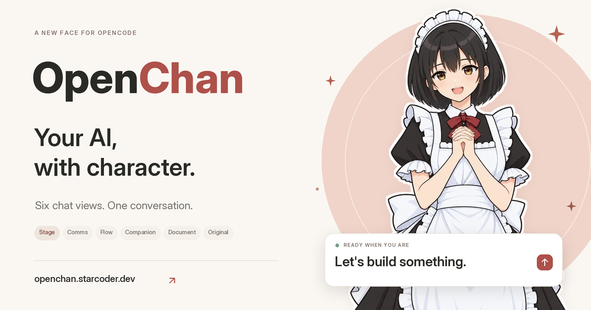
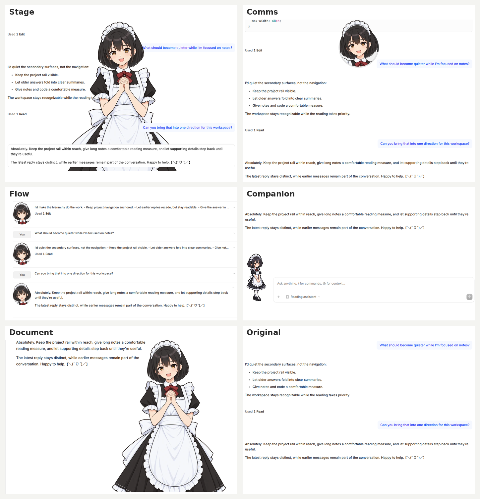

# OpenChan

A character-centered web UI for [OpenCode V2](https://opencode.ai/v2/docs/). Switch between six chat views with expressive portraits while keeping the same conversations, tools, attachments, and drafts.

OpenChan adds Kotone's persona, expression instructions, and your browser's local time when you send a message, unless the ClaudeCafe server plugin is active. No ClaudeCafe installation is required; the built-in persona uses OpenCode's experimental Session Instructions API.

## How to Use

Run these commands on the machine running OpenCode:

```bash
opencode service set cors https://openchan.starcoder.dev
opencode pair
```

Then open **<https://openchan.starcoder.dev>**, paste the **full pairing URL** into **Server address**, and select **Connect**.

**No password is needed when using a pairing URL.** Leave **Password** empty; the link handles authentication for you.

Do not open the pairing link first: it is single-use and expires after a short time. Run `opencode pair` again if it expires or has already been used.

Your browser connects directly to your OpenCode service. It must be able to reach the server, such as over your local network or VPN. Allow local-network access if your browser asks; if it blocks HTTP connections from the HTTPS site, use an HTTPS endpoint for your server.

Set **Settings → OpenChan → Response language** to choose how the assistant replies. This browser-local preference is applied to the session on your next send, including when ClaudeCafe is active. Leave it empty to follow the conversation.

## Chat Views

Choose a view from **Chat view** in the session header. Switching views preserves your session and composer draft.

- **Stage** — a large portrait behind the conversation, with the latest replies in front.
- **Comms** — a floating, pop-out avatar with a context-usage ring; chat scrolls behind it.
- **Flow** — compact, collapsible messages with per-message avatars.
- **Companion** — a small animated character beside the composer.
- **Document** — continuous illustrated papers, one prompt and its responses per paper.
- **Original** — the native conversation without character artwork.



Screenshots use an illustrative demo conversation.

## Self-Hosting

Build the standalone web client from the repository root:

```bash
bun install
VITE_OPENCODE_SERVER_MODE=none OPENCODE_CHANNEL=prod bun run build:web
```

Serve `packages/app/dist/` with a static host configured to fall back to `index.html` for application routes. Use your site's origin in the CORS command above.

Character artwork is not included in this repository. Supply it under `packages/app/public/characters/` before building to include portraits and animations in your deployment.

Cloudflare deployment configuration and instructions are in [`deployment/`](deployment/).

## Development

```bash
bun run dev:web
bun run check
```

See [chat view implementation notes](packages/app/src/session/layouts/README.md) for layout ownership and presentation tests.

This repository contains the web client and its shared dependencies. Run the OpenCode server separately; CLI, desktop, and upstream hosted services are not included.

## Credits

Built on [OpenCode](https://github.com/anomalyco/opencode). OpenChan is an independent project and is not affiliated with the OpenCode team.

## License

[MIT](LICENSE)
